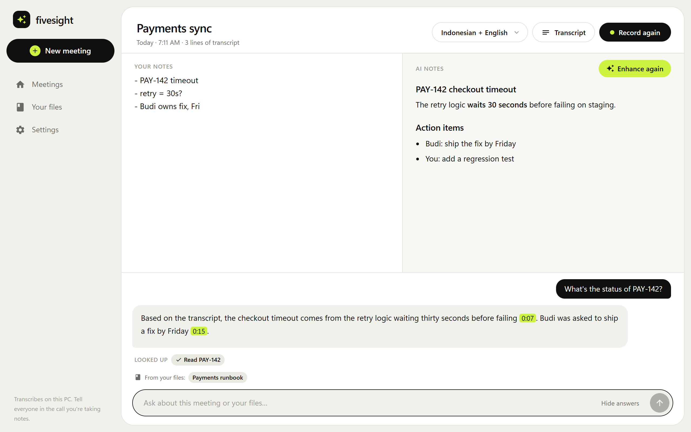
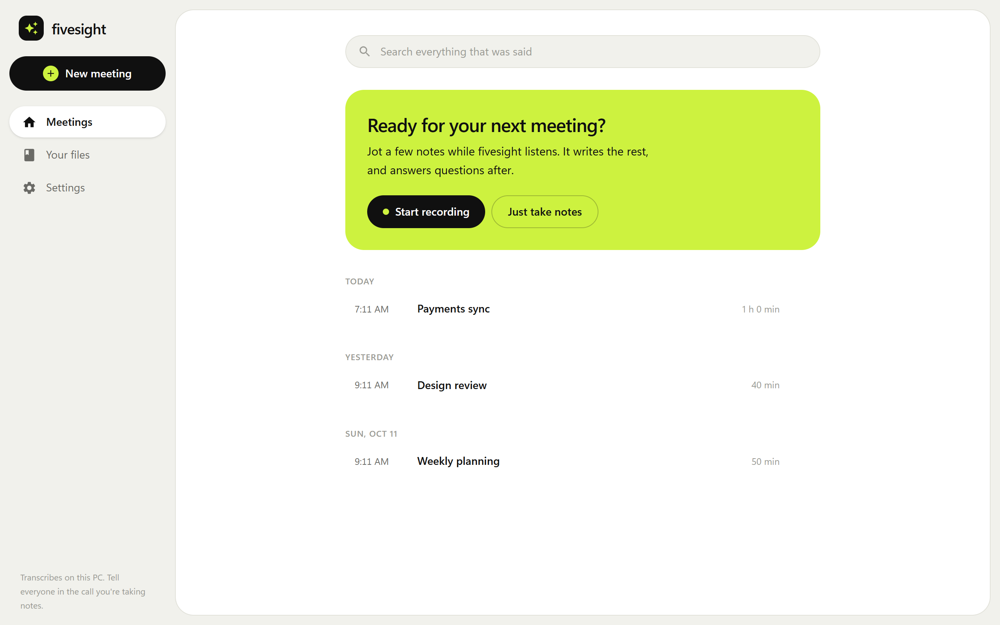
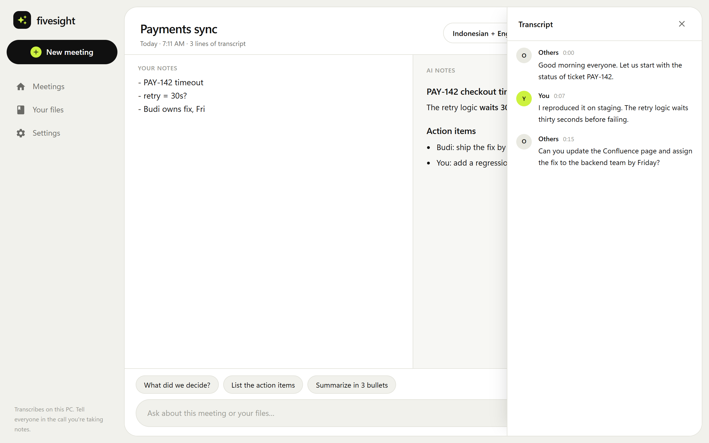
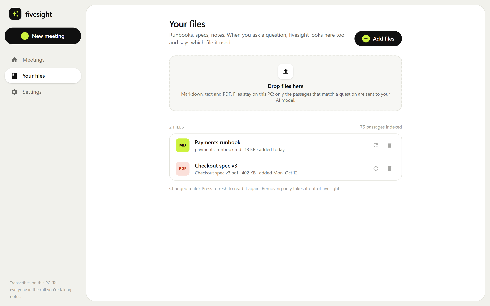

# fivesight

A meeting notepad for Windows that listens on your own PC. Jot shorthand while you talk;
fivesight writes it up from what was said, and answers questions about the meeting, your own
files, and your Jira tickets.

Speech is transcribed locally with [whisper.cpp](https://github.com/ggml-org/whisper.cpp) on your
GPU. There is no meeting bot: fivesight hears what your PC hears (your microphone and the call
audio), so it works with any meeting app.

> **Status:** early. It runs well on the author's machine; expect rough edges elsewhere.



| | | |
|---|---|---|
|  |  |  |
| Meetings | Transcript drawer | Your files |

## Features

- **Notes first.** Your notes on the left, AI-expanded notes on the right, written from your
  notes and the transcript. Or let the AI take the notes on one page that you correct and add to
  as it goes; it keeps your edits. The live transcript stays in a drawer.
- **Follow-up meetings.** Attach the earlier meeting a call continues, and the AI notes and Ask
  pick up its open questions and action items. Attach a Confluence page to read it in full, with
  its comment threads.
- **Ask.** Questions about the open meeting or all past meetings, answered with `[m:ss]`
  timestamp citations. Add an answer to your notes in one click; pasted text keeps its formatting.
- **Your files.** Add Markdown, text and PDF files; Ask uses the passages that match a question
  and says which file it used. Files are indexed on your PC.
- **Jira and Confluence, read-only.** Jira through Atlassian's official CLI (`acli`), Confluence
  through [confluence-cli](https://github.com/pchuri/confluence-cli). Ask can search and read
  tickets, and search and read Confluence pages. It can't create, edit, comment, assign or move
  anything: every command is checked against an exact allowlist before it runs.
- **Indonesian and English.** Per-meeting language: Indonesian, English, or both with sticky
  per-sentence detection for code-switching.
- **Google Meet extension (optional).** Names who is speaking in the transcript and offers to
  start recording when you join a call. It never sends audio or video, shows nothing on the Meet
  page, and only talks to the app on `127.0.0.1`.
- **Bring your own model.** Any OpenAI-compatible endpoint: OpenRouter, OpenAI, Gemini, Groq,
  Together, a company gateway, or a local server such as Ollama or LM Studio. Keys are stored in
  Windows Credential Manager, one per server.

## Privacy

- Audio never leaves your PC, and recordings are not kept: only the transcript is stored, in a
  local SQLite database.
- Meeting text, matching file passages and ticket text go to the AI model you configure, only
  when you enhance notes or ask a question. Use a local model to keep everything on your PC.
- **Tell people you're transcribing.** fivesight doesn't hide; please don't use it to.

## Requirements

- Windows 10 or 11
- An NVIDIA GPU with a recent driver (CUDA). About 2 GB of VRAM for `large-v3-turbo`.

## Building from source

Install:

- [Rust](https://rustup.rs) (stable) and [Node.js](https://nodejs.org) 20 or newer
- Visual Studio 2022 Build Tools with "Desktop development with C++"
- [CMake](https://cmake.org/download/), [LLVM](https://github.com/llvm/llvm-project/releases)
  (for libclang), and the [CUDA Toolkit](https://developer.nvidia.com/cuda-downloads)

`scripts\env.bat` expects these in their default install locations. It builds for compute
capability 12.0 (RTX 50 series); set `FS_CUDA_ARCH` for other cards, e.g. `86` for RTX 30 or
`89` for RTX 40.

Download the speech models into `%LOCALAPPDATA%\fivesight\models`:

- `ggml-large-v3-turbo.bin` from
  [ggerganov/whisper.cpp](https://huggingface.co/ggerganov/whisper.cpp/tree/main)
- `silero_vad.onnx` from
  [snakers4/silero-vad](https://github.com/snakers4/silero-vad/tree/master/src/silero_vad/data)

Then run the app in development mode:

```
cd app
npm install
cd ..
scripts\dev.bat
```

The first build takes several minutes (whisper.cpp with CUDA).

### Meet extension

1. Open `chrome://extensions`, turn on Developer mode, and choose **Load unpacked**.
2. Pick the extension folder. The installed app ships one: **Settings → Google Meet → Open
   extension folder**. When running from source, pick this repo's `extension` folder.
3. In fivesight, open **Settings → Google Meet**, copy the pairing code, and paste it into the
   extension's popup.

**Updating:** when a new fivesight comes with a newer extension, Settings says so. Open
`chrome://extensions` and press the reload arrow on fivesight for Meet.

See [extension/README.md](extension/README.md) for how it works.

### Jira and Confluence

For Jira, install [acli](https://developer.atlassian.com/cloud/acli/guides/install-windows/) and
log in:

```
acli jira auth login --web
```

For Confluence, install [confluence-cli](https://github.com/pchuri/confluence-cli) and set it up
with your site and an API token:

```
npm install -g confluence-cli
confluence init
```

**Settings → Jira & Confluence** shows what fivesight can see.

## Project layout

| Path | What |
|---|---|
| `app/` | Tauri 2 desktop app: Rust commands in `src-tauri/`, Svelte 5 UI in `src/` |
| `crates/fs-audio` | WASAPI microphone and system-audio capture at 16 kHz |
| `crates/fs-vad` | Silero voice activity detection and utterance endpointing |
| `crates/fs-stt` | whisper.cpp engine, hallucination filter, Indonesian/English language choice |
| `crates/fs-pipeline` | Capture → VAD → transcription, with live partials |
| `crates/fs-store` | SQLite storage and full-text search |
| `crates/fs-llm` | OpenAI-compatible streaming client, tool calls, prompts |
| `crates/fs-kb` | Reads and splits Markdown, text and PDF files |
| `crates/fs-atlassian` | Read-only `acli` and `confluence-cli` wrappers and their allowlists |
| `crates/fs-bridge` | Local endpoint for the Meet extension |
| `extension/` | Chrome extension for Google Meet speaker names |
| `cli/` | Headless benchmark, recording replay and live-transcription tool for tuning |

## Contributing

See [CONTRIBUTING.md](CONTRIBUTING.md).

## License

[MIT](LICENSE)
